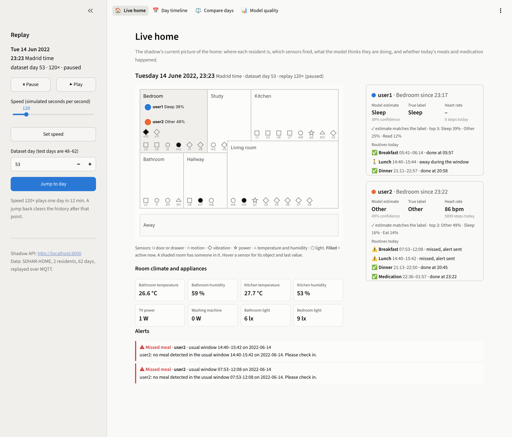
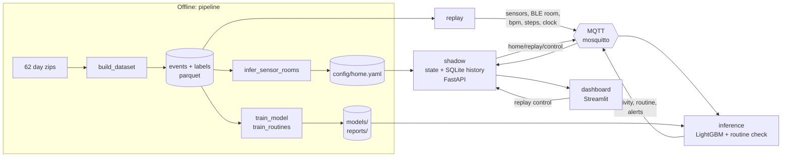
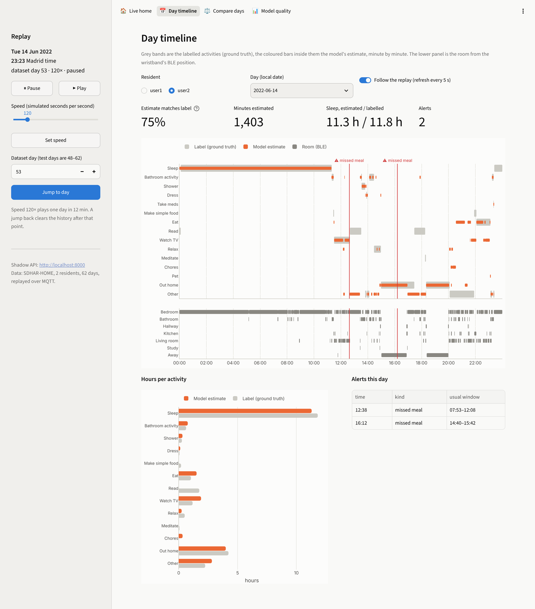
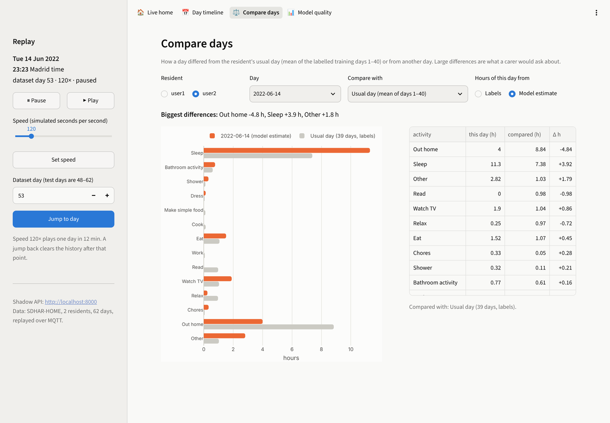
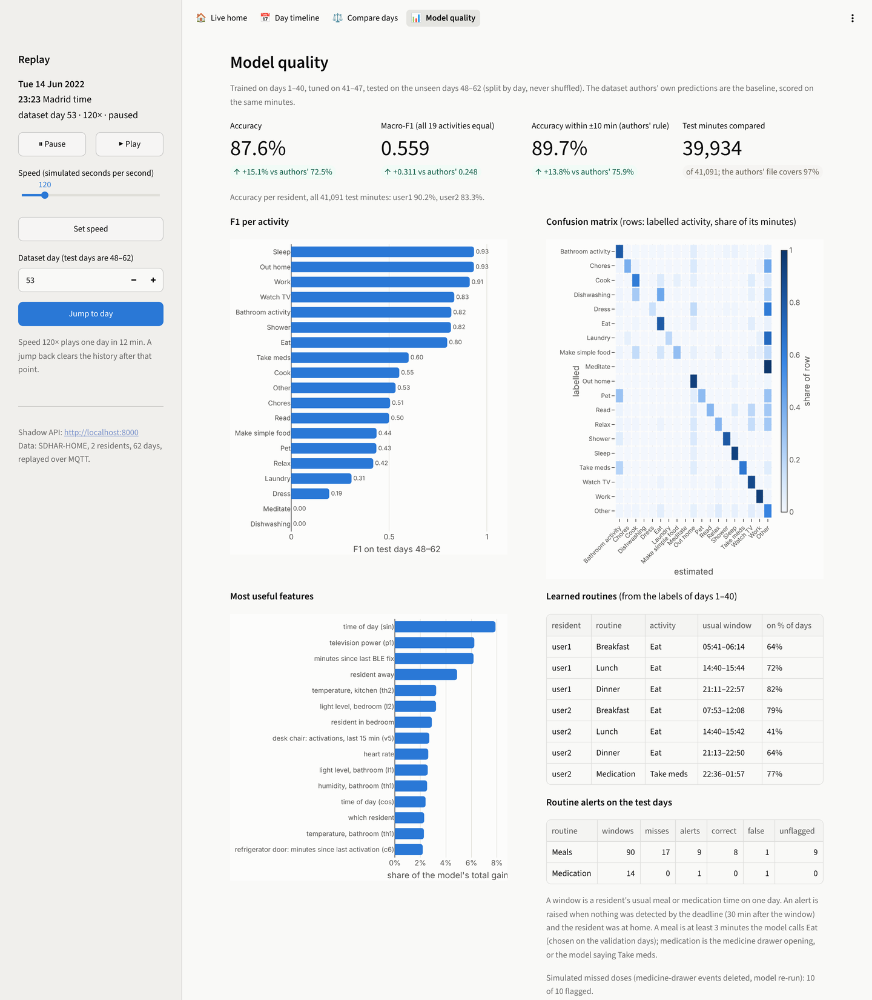

# SDHAR-HOME digital shadow

Digital shadow of a two-resident smart home for home-care monitoring (DTE, UvA, group 14).
Sensor recordings from [SDHAR-HOME](https://github.com/raugom13/SDHAR-HOME-A-Sensor-Dataset-for-Human-Activity-Recognition-at-Home)
are replayed through an MQTT broker as if the home were live. A shadow service keeps the state of rooms, sensors
and residents; a classifier estimates what each resident is doing every minute; a routine checker raises an alert
when a resident misses a usual meal or their medication; a dashboard shows all of it.

It is a *shadow*, not a twin: data flows one way, from the (replayed) home into the model. Nothing is sent back.



## Architecture



Five containers (`docker-compose.yml`): `mosquitto`, `replay`, `shadow`, `inference`, `dashboard`.

| Service | Does | Talks to |
| --- | --- | --- |
| `replay` | publishes the recorded events when the simulated clock passes them (default 300x, test days 48-62); seek / speed / pause over MQTT | MQTT out, `home/replay/control` in |
| `shadow` | keeps the live model of the home (below) and its history in SQLite; HTTP + WebSocket API | MQTT in, HTTP out |
| `inference` | every simulated minute: 158 features per resident from a rolling event buffer, LightGBM activity estimate, routine check | MQTT in and out |
| `dashboard` | live floor plan, residents, alerts, day timeline, day comparison, model quality, replay controls | shadow API |

## Representation model

| Entity | Attributes | Source |
| --- | --- | --- |
| Home | rooms, residents, simulated clock | `config/home.yaml`, replay clock |
| Room | floor-plan box, occupants, sensors, active sensors | config + live |
| Sensor | type, room, household object, value, readings per quantity, last change, active now | config (inferred room + curated object, with evidence) + live |
| Resident | room (BLE, "away" after 10 min without a fix), heart rate, steps, estimated activity + confidence + top 3, labelled activity | live + model + labels |
| Routine | usual window per meal / medication, deadline, today's status (pending, done, missed, away) | learned on days 1-40 + live |
| Alert | resident, kind (missed meal / medication), usual window, message | routine checker |

The dataset has no sensor-to-room map. `pipeline/infer_sensor_rooms.py` votes with the residents' BLE room at the
moment each sensor fires (only moments when one resident is home, normalised by time spent per room), and
`config/sensor_objects.yaml` names each sensor's object with the evidence (e.g. `c2` medicine drawer: TAKE MEDS lift
80, opened within 2 min of 68 of the 73 medication episodes).

## Dashboard

Streamlit, four pages that read the shadow API (the live page every 2 s); the sidebar plays, pauses, speeds up or
jumps the replay.

| Page | Shows |
| --- | --- |
| Live home | floor plan with residents and active sensors, model estimate next to the label for each resident, today's meals and medication, room climate, alerts |
| Day timeline | one day minute by minute: labels (grey) against the model's estimate, the BLE room, alert times, hours per activity |
| Compare days | hours per activity against the resident's usual day (mean of training days) or another day |
| Model quality | test scores against the authors' baseline, F1 per activity, confusion matrix, most useful features, learned routines, alert scores |

| Day timeline | Compare days | Model quality |
| --- | --- | --- |
|  |  |  |

The screenshots are 2022-06-14 (test day 53), user2: breakfast and lunch were skipped and both raised an alert;
the medication, taken at 23:21, was marked done at 23:22.

## Results (test days 48-62, never seen in training)

Split by day, never shuffled: train 1-40, validation 41-47 (early stopping), test 48-62.
Baseline: the dataset authors' own predictions (`activity_predicted_user_*` files), scored on the same minutes.

| Test days, same 39,934 minutes | Ours | Authors |
| --- | --- | --- |
| Accuracy | **87.6%** | 72.5% |
| Macro-F1 (19 activities weigh the same) | **0.559** | 0.248 |
| Accuracy if the activity occurs within ±10 min (authors' rule) | **89.7%** | 75.9% |

Per activity (F1): sleep 0.93, out of home 0.93, work 0.91, watch TV 0.83, bathroom 0.82, shower 0.82, eat 0.80,
take meds 0.60; rare ones are weak (dress 0.19, meditate and dishwashing 0). Details: `reports/`.

Routine alerts on the test days (`reports/alerts.json`):

| Routine | Windows | Real misses | Alerts | Correct | False | Misses not flagged |
| --- | --- | --- | --- | --- | --- | --- |
| Meals | 90 | 17 | 9 | 8 | 1 | 9 |
| Medication | 14 | 0 | 1 | 0 | 1 | 0 |

Simulated missed doses (the medicine-drawer events of each real dose deleted, the model re-run): 10 of 10 flagged.

How many minutes of EAT make a meal was chosen on the validation days (`pipeline/tune_meal_rule.py`,
`reports/meal_rule.json`): with 3 minutes, 2 of the 9 real misses raise an alert and none is false; with 10 minutes,
4 of 9, but 5 false alerts in 7 days. We keep 3 minutes, because an alert has to be believable (best F0.5, which
weighs precision double). Counting EAT from 30 minutes before the window or only from its start made no difference.

## Run it

```bash
pip install -r requirements.txt
./scripts/download_data.sh              # ~900 MB, 62 day zips into data/raw/SDHAR-HOME
python -m pipeline.build_dataset        # -> data/clean/events.parquet, labels.parquet (~40 s)
docker compose up --build               # dashboard http://localhost:8501, API http://localhost:8000/docs
```

`config/home.yaml`, `models/` and `reports/` are in the repo, so the three steps above are enough. To redo them:
`python -m pipeline.infer_sensor_rooms`, `python -m pipeline.train_model` (~3 min),
`python -m pipeline.train_routines` (~30 s), `python -m pipeline.tune_meal_rule` (~2 min).

Replay options: `REPLAY_SPEED=600 REPLAY_DAYS=52-54 docker compose up`. At runtime use the dashboard's sidebar,
`POST /replay` (`{"action": "seek", "day": 53}`, `{"action": "speed", "value": 1200}`, `{"action": "pause"}`), or
publish the same JSON to `home/replay/control`. A seek backwards clears the shadow's history after that point.

Without Docker (four terminals, a local broker on 1883):

```bash
python -m services.replay.main
uvicorn services.shadow.app:app --port 8000
python -m services.inference.main
streamlit run services/dashboard/app.py
```

## Tests

```bash
pip install -r requirements-dev.txt
python -m pytest -q                     # 29 tests, ~1 min (data-dependent ones skip without data/clean)
python scripts/smoke_test.py            # against a running stack
```

* `test_features`: online features (rolling buffer) equal offline features (whole dataset).
* `test_routines`: windows learned from labels (also across midnight); done / missed / away; drawer evidence.
* `test_shadow`: sensor state, motion expiry, "away" after 10 min, seek back, timeline segments, the HTTP API.
* `test_replay`: events go out in time order on the right topics; seek, speed, pause.
* `test_dashboard`: the dashboard's figures build from API data.
* `test_end_to_end`: a real morning (2022-06-14) replayed through inference and shadow in one process; every
  minute gets an estimate, estimates match the labels, user2's missed breakfast raises an alert.

CI (`.github/workflows/ci.yml`) downloads the data, runs the tests, starts all five containers and runs the smoke test.

## Layout

| Path | What |
| --- | --- |
| `shadowhome/schema.py` | Shared names: activities, rooms, MQTT topics, file paths, day split |
| `shadowhome/features.py` | Features per resident-minute, same code offline and online |
| `shadowhome/routines.py` | Routine learning and the day-by-day checker |
| `pipeline/build_dataset.py` | Raw zips -> one clean event table + activity intervals (+ authors' predictions) |
| `pipeline/infer_sensor_rooms.py` | Infers each sensor's room from residents' BLE positions -> `config/home.yaml` |
| `pipeline/train_model.py`, `train_routines.py`, `tune_meal_rule.py` | Model training and evaluation, routine evaluation, choice of the meal rule |
| `services/{replay,shadow,inference,dashboard}` | One folder per service |
| `config/` | Floor plan, sensor -> room/object map with evidence |
| `models/`, `reports/` | Trained model, learned routines, test results |

## Data notes

* 62 days (2022-04-23 to 2022-06-23), 2 residents, 33 ambient sensors, BLE room per resident, wristband bpm/steps.
* Wristband `gyro.csv` is skipped: ~95% of the raw size and not needed for room-level activities.
* Labels are change points; they become intervals lasting until the next change (capped at 14 h).
* Timestamps are UTC; the home is in Spain, so everything shown is Europe/Madrid time. The day files are cut at
  UTC midnight (02:00 local).

## MQTT topics

| Topic | Publisher | Payload |
| --- | --- | --- |
| `home/sensors/{type}/{id}` | replay | `{ts, sensor_id, sensor_type, room, value, state}` |
| `home/residents/{user}/location` | replay | `{ts, user, room, distance}` |
| `home/residents/{user}/bpm`, `/steps` | replay | `{ts, user, value}` |
| `home/replay/clock` (retained) | replay | `{sim_ts, speed, day, paused, days}` |
| `home/replay/control` | dashboard via shadow | `{action: seek/speed/pause/resume, ...}` |
| `home/residents/{user}/activity` | inference | `{ts, user, activity, confidence, probs, model_version}` |
| `home/residents/{user}/routine` | inference | `{ts, user, items: [{activity, window, date, deadline, status, done_at}]}` |
| `home/alerts` | inference (routine checker) | `{ts, user, kind, expected_at, date, message}` |

## Limitations

* BLE rooms are noisy (short jumps between rooms); the model learns around it, the floor plan shows it as it is.
* Rare activities (dress, dishwashing, meditate) have too few examples to learn.
* Meal evidence is the model saying EAT; when it says EAT for a few minutes near a meal time, a skipped meal can
  pass as done (most of the unflagged misses). Medication also counts the medicine-drawer sensor, which is why
  simulated missed doses are caught.
* Routines are learned once from days 1-40; a real system would keep updating them.
